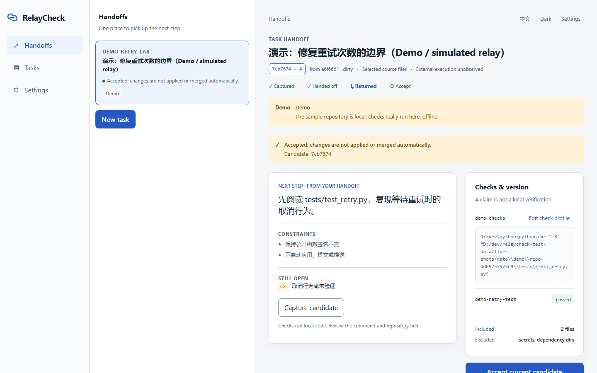
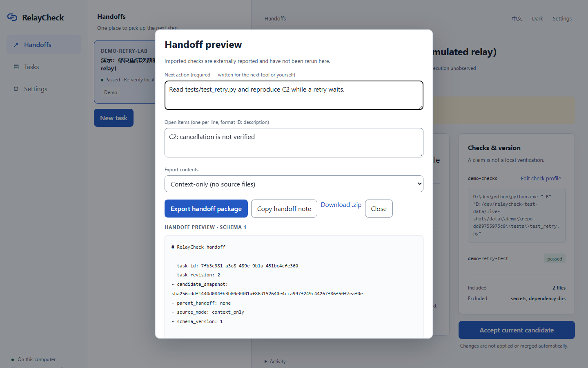
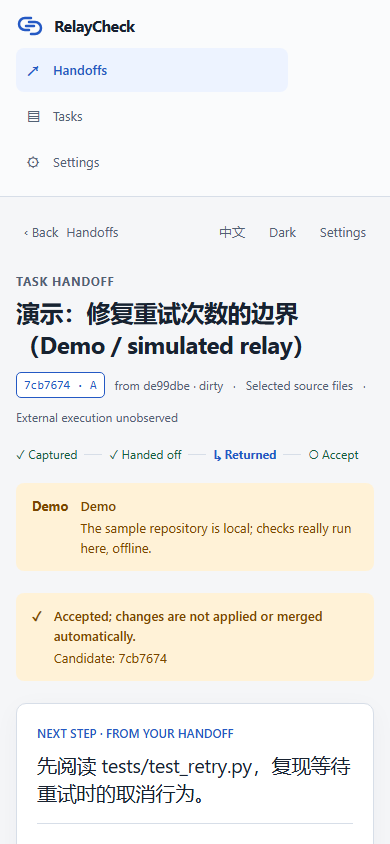

# RelayCheck

[](https://github.com/xiaofeilovecoding/relaycheck/actions/workflows/ci.yml) · [简体中文](README.zh-CN.md)

**Switch tools. Keep the task and checks in sync.**

RelayCheck is a small local workspace for handing coding tasks between
tools — with file versions, checks, and the next step kept together.

- **Know where to continue.** The handoff card states the goal, constraints,
  open items and the next action — written for the next tool or for you.
- **Review what came back.** When candidate B returns, the change list is
  computed against the exact snapshot you handed off — never "latest HEAD".
- **Accept the version you actually checked.** A passing result is bound to
  one snapshot. Change the files and the old pass no longer counts.





## What it is (and is not)

RelayCheck runs one local service on your machine: register a Git project,
capture a candidate snapshot, run checks you explicitly approve, export an
open handoff package, and bring the returned work back as a new candidate
with a real change list. The service stores its data locally. Approved
check commands run under your account and can access resources your account can access.

It is **not** an agent scheduler, not a model proxy, and not a code-quality
guarantee. It does not apply, merge or push anything by itself, and it does
not authenticate who sent a package — hashes bind content, not senders.

| | |
|---|---|
| Platforms | Windows x64. CI runs the full CLI and Web suite on Windows; Ubuntu runs the frontend build and portable Rust unit tests. |
| Install | none — one executable, your existing Git and Python |
| Network | localhost only; no account, no API key |
| Data | SQLite + content-addressed blobs under your data directory |

## Quick start

Use the executable from a successful [CI run](https://github.com/xiaofeilovecoding/relaycheck/actions/workflows/ci.yml), or build from source below.
Requirements: [Git](https://git-scm.com) on PATH. Python (or
anything you approve as a check command) only if you want to run checks.

```text
relaycheck serve
```

The launcher prints a one-time URL — open it in your browser to start a
session (the token in the `#rcb=` fragment is single-use and is cleared
immediately).

```text
relaycheck attach D:\path\to\your-repo
```

Registers a Git project and prints a one-time claim code; paste it in the
web UI to see the project. Then:

1. Create a task: goal, constraints, success criteria.
2. **Capture candidate** — confirms the original tool has stopped writing,
   records every selected file's exact bytes (SHA-256 manifest).
3. Save a check profile (e.g. `python.exe -m pytest`) and **Run local
   checks** — they run on a scratch copy of the candidate, never on your
   working tree. A printed `PASS` is never trusted; exit code plus
   unchanged inputs decide.
4. **Preview & export handoff** — an open ZIP (`context-only` without
   sources, or `portable-source` with blobs). Continue the task in any
   tool; the package is plain data and readable without RelayCheck.
5. When the work comes back: capture or import it as candidate **B** — the
   change list is computed against the handed-off snapshot A.
6. Re-run the checks on B, then **accept** — the acceptance is bound to
   (revision, snapshot, profile, environment) and cannot be resurrected
   from stale results.

### CLI

```text
relaycheck tasks
relaycheck capture --task <task-id> [--untracked a,b] [--json]
relaycheck verify  --task <task-id> [--json]
```

Exit codes: `0` ok · `1` checks failed · `2` bad arguments · `3` blocked or
conflict · `4` internal error · `5` stop state unknown.

## Try the sample

First run shows **Try the sample** — it creates a real small repository
under the data directory, runs one real local check, and walks the whole
A→B loop. It is labelled *Demo* everywhere and never touches the network.

## Handoff package format

An open ZIP, schema 1: `README.md`, `handoff.md` (seven sections),
`receipt.json`, `manifest.json`, and in portable-source mode `blobs/<sha256>`
with the exact file bytes. Read it with any unzip tool; nothing executes.
Schemas: [`schemas/receipt.schema.json`](schemas/receipt.schema.json),
[`schemas/manifest.schema.json`](schemas/manifest.schema.json). API surface
and error codes: [`docs/api.md`](docs/api.md).

## Trust copy

These statements are enforced by the product, not just written here:

- Stored locally. Nothing is sent to an agent automatically.
- External execution is unobserved. Confirm the original tool has stopped.
- This check runs local code. Review the repository and command first.
- This passing result applies to snapshot A. The current candidate is B.
- Imported checks are externally reported and have not been rerun here.
- Snapshot B accepted. Changes are not applied or merged automatically.

## Privacy & security

Data lives under your local data directory (`--data-dir` to move it).
Capture blocks high-confidence secrets outright; check output is redacted
before it is stored; the handoff text is scanned before export. The web UI
binds to `127.0.0.1`, requires a one-time bootstrap, CSRF and same-origin
checks, and ships a self-only CSP. See
[SECURITY.md](SECURITY.md) for reporting and
[threat-model notes](SECURITY.md#scope).

## Development

```text
npm --prefix web ci
npm --prefix web run build
cargo test --locked
cargo build --release --locked
```

The frontend build must precede Cargo so the executable can embed the assets.
See [CONTRIBUTING.md](CONTRIBUTING.md) for the browser gate and contribution workflow.



## License

[MIT](LICENSE) · [Third-party notices](NOTICE)
