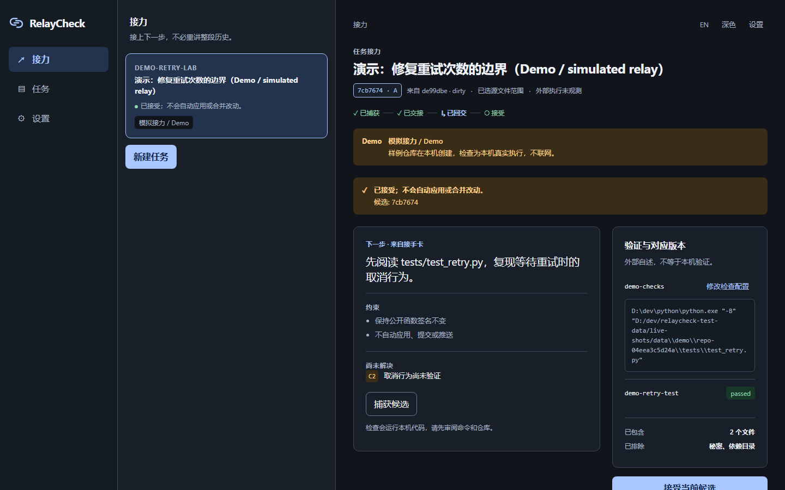

# RelayCheck

**换工具，接着做；改动与验证对得上。**

RelayCheck 是一个本机小工作区：把编码任务在工具之间交接——文件版本、检查
和下一步始终放在一起。

- **知道从哪儿继续。** 接手卡写清目标、约束、未决项和下一步，给下一个工具
  或给你自己。
- **看清回交改了什么。** 候选 B 回来时，变化清单永远对照你交出去的那份快照
  A 计算——不是“最新 HEAD”。
- **接受你真正检查过的版本。** 通过记录绑定在某个快照上；文件一变，旧通过
  不再算数。



## 它是什么（以及不是什么）

RelayCheck 在本机运行一个服务：登记 Git 项目、捕获候选快照、运行你明确
批准的检查、导出开放的接手包、把回交的工作作为新候选接回并给出真实变化
清单。它不会自动调用任何编码工具，任何内容都不会离开这台电脑。

它**不是**任务调度器、不是模型代理、也不是代码质量保证。它不会自动
apply/merge/push，也不认证包的发送者——哈希绑定的是内容，不是人。

| | |
|---|---|
| 平台 | Windows 10 x64（本机实测）；Linux/CI 未实测——如实状态见交付说明 |
| 安装 | 无——单可执行文件，用你已有的 Git 和 Python |
| 网络 | 仅 localhost；无账号、无 API Key |
| 数据 | SQLite + 内容寻址 blob，存放在你的数据目录 |

## 快速开始

需要：Windows 10+，PATH 里有 [Git](https://git-scm.com)。只有要运行检查时
才需要 Python（或你批准的其他命令）。

```text
relaycheck serve
```

启动器会打印一个一次性 URL，用浏览器打开即建立会话（`#rcb=` 里的令牌
只能用一次，并立即从地址中清除）。

```text
relaycheck attach D:\path\to\your-repo
```

登记一个 Git 项目并打印一次性认领码；在网页里粘贴即可看到项目。然后：

1. 建任务：目标、约束、成功条件。
2. **捕获候选** —— 需确认原工具已停止写入，逐文件记录精确字节
   （SHA-256 manifest）。
3. 保存检查配置（如 `python.exe -m pytest`）并**运行本机检查** —— 检查在
   候选的独立副本上运行，不碰你的工作区。打印的 `PASS` 一律不作为判定；
   退出码加输入未变才算通过。
4. **预览并导出接手卡** —— 开放 ZIP（`context-only` 不含源码，
   `portable-source` 附带 blobs）。用任何工具继续任务；包是纯数据，
   不装 RelayCheck 也能读。
5. 工作回来后：捕获或导入为候选 **B** —— 变化清单对照快照 A 计算。
6. 对 B 重跑检查，然后**接受** —— 接受绑定
   （revision, snapshot, profile, environment），旧结果无法复活。

### CLI

```text
relaycheck tasks
relaycheck capture --task <任务ID> [--untracked a,b] [--json]
relaycheck verify  --task <任务ID> [--json]
```

退出码：`0` 成功 · `1` 检查失败 · `2` 参数错误 · `3` 阻塞/冲突 ·
`4` 内部错误 · `5` 停止状态未知。

## 试用样例

首次启动会看到**试用样例**：在本机数据目录创建一个真实的小仓库，跑一次
真实的本机检查，完整走一遍 A→B 流程。全程标“模拟接力 / Demo”，不联网。

## 接手包格式

开放 ZIP，schema 1：`README.md`、`handoff.md`（七段）、`receipt.json`、
`manifest.json`；portable-source 模式附 `blobs/<sha256>`（逐字节原文件）。
任何解压工具都能读；包内任何内容都不会自动执行。Schema：
[`schemas/receipt.schema.json`](schemas/receipt.schema.json)、
[`schemas/manifest.schema.json`](schemas/manifest.schema.json)；
接口与错误码：[`docs/api.md`](docs/api.md)。

## 信任文案

以下文案由产品行为保证，不只是写在这里：

- 本机保存，不自动发送给编码工具。
- 外部执行未观测，请在原工具确认已停止。
- 此检查会运行你的本机代码，请先审阅仓库与命令。
- 此通过结果只适用于快照 A；当前为 B。
- 导入的验证由外部报告，尚未在此电脑重跑。
- 已接受快照 B；不会自动应用或合并改动。

## 隐私与安全

数据保存在本机数据目录（`--data-dir` 可指定）。捕获会直接阻断高置信秘密
文件；检查输出先脱敏再保存；接手卡导出前会扫描。Web UI 绑定 `127.0.0.1`，
要求一次性引导、CSRF 与同源校验，并携带仅限自身的 CSP。见
[SECURITY.md](SECURITY.md)。

## 开发

```text
cargo test            # 单元 + 集成门禁（R01–R14 套件）
cd web && npm install && npm run build   # 重新构建内嵌 UI
cargo build --release
```

门禁映射（R01–R21）与截图脚本见 [CONTRIBUTING.md](CONTRIBUTING.md)。这是
0.1 评审候选——详见交付报告中“尚未验证”的部分。

## 许可

MIT —— 见 [NOTICE](NOTICE)。
